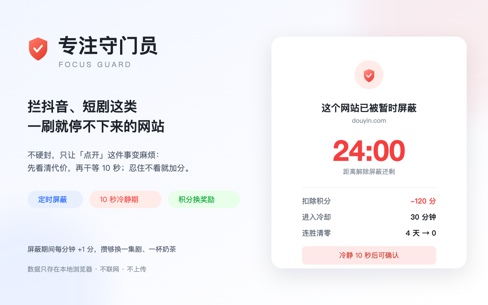

# 专注守门员 · Focus Guard



一个用于「网站访问自我节制」的 Chrome 扩展（Manifest V3）。核心不是简单地把网站封死，而是：**提高一次冲动的成本，同时让坚持变得有回报**。

> 使用说明见 [`docs/USAGE.md`](docs/USAGE.md)，版本变更见 [`CHANGELOG.md`](CHANGELOG.md)，发布流程（GitHub Releases / Packages）见 [`docs/RELEASING.md`](docs/RELEASING.md)；
> 封面图源文件为 [`docs/cover.svg`](docs/cover.svg) 与 [`docs/poster.svg`](docs/poster.svg)，`npm run cover` 可重新导出 PNG。

---

## 一、功能总览

| 能力 | 说明 |
| --- | --- |
| 黑名单管理 | 域名级匹配（自动包含全部子域名），支持快捷添加、删除、清空，数据持久化在 `chrome.storage.local` |
| 一键屏蔽 | 弹窗顶部开关 + 快捷时长（25/45/90/120/240/480 分钟），**点击即刻生效**，无需重启浏览器 |
| 访问拦截 | 命中黑名单的页面被 `declarativeNetRequest` 重定向到白屏警告页，展示剩余时间倒计时、屏蔽来源 |
| 定时屏蔽 | 按「星期 + 时间段」配置自动屏蔽，支持跨零点（如 23:00–02:00） |
| 手动解除 | 两档：**提前解除（有代价）** 与 **自由通行证（免罚）** |
| 奖励机制 | 专注积分、连续达标连胜、成就徽章、积分商店（兑换真实奖励） |
| 惩罚机制 | 扣分、指数递增冷却、连胜清零、严格模式、承诺语确认 |
| 数据 | 一键导出 JSON 备份 / 导入恢复 / 重置统计 |

---

## 二、安装与运行

```bash
npm install
npm run build      # 产物输出到 dist/
```

然后在 Chrome 中：

1. 打开 `chrome://extensions/`
2. 右上角开启「开发者模式」
3. 点击「加载已解压的扩展程序」，选择本项目的 **`dist` 目录**

> 修改源码后重新 `npm run build`，并在扩展页点一次「刷新」即可。
> `npm run dev` 可以监听源码变化自动重建。

首次使用建议顺序：**黑名单** 加几个站点 → **状态** 页设定时长并开启一键屏蔽 → 试着访问被屏蔽站点，确认白屏页正常 → 到 **规则** 页按自己的作息调参。

---

## 三、目录结构

```
focus-guard/
├─ public/
│  ├─ manifest.json           # MV3 清单（构建时原样拷贝）
│  └─ icons/                  # 由 scripts/gen-icons.mjs 生成
├─ scripts/gen-icons.mjs      # 纯 Node 生成 PNG 图标（无第三方依赖）
├─ src/
│  ├─ background/index.js     # Service Worker：唯一写者 + DNR 规则同步 + 闹钟 + 指令路由
│  ├─ shared/
│  │  ├─ time.js              # 时间/格式化工具
│  │  ├─ constants.js         # 徽章、商店、快捷时长、预设站点
│  │  ├─ state.js             # 状态默认值、迁移、读写
│  │  ├─ blocking.js          # 域名规整、定时窗口、屏蔽状态计算（纯函数）
│  │  ├─ reward.js            # 积分累积、徽章、跨天连胜结算（纯函数）
│  │  └─ punish.js            # 解除代价预览与结算（纯函数）
│  ├─ popup/                  # 控制台（Vue 3 + Arco Design Vue）
│  │  ├─ App.vue
│  │  └─ views/{Status,Sites,Schedule,Reward,Rules}View.vue
│  └─ blocked/                # 白屏拦截页（原生 JS，追求首屏零延迟）
└─ vite.config.js             # 多入口：popup / blocked / background
```

**架构要点**

- **单写者**：所有状态变更都通过 `chrome.runtime.sendMessage` 交给 Service Worker 串行执行，避免弹窗、拦截页、闹钟并发写冲突。
- **纯函数内核**：`blocking.js / reward.js / punish.js` 不依赖任何 Chrome API，可脱离浏览器直接单测。
- **规则签名**：Service Worker 会把「当前应生效的规则」哈希后存到 `chrome.storage.session`，签名不变则跳过 DNR 调用，避免拦截页每秒轮询时反复改规则。

---

## 四、奖励与惩罚机制（方案说明）

设计原则：**奖励要即时可见，惩罚要提前可见**。
人在冲动当下是不理性的，所以惩罚不能只是事后追责，必须**在按下解除按钮之前就把代价摊开**——本扩展在解除确认弹窗 / 拦截页面板里会先列出「扣多少分、冷却多久、连胜是否清零」，并强制 10 秒冷静倒计时。

### 4.1 奖励：形式与触发条件

| # | 形式 | 触发条件 | 数值 / 规则 |
| --- | --- | --- | --- |
| R1 | **专注积分**（即时） | 屏蔽生效期间，每满 1 分钟自动结算 | 基础 1 分/分钟；定时屏蔽 ×1.2；严格模式 ×1.5 |
| R2 | **达标奖励分**（每日） | 当日累计专注分钟数 ≥ 每日目标（默认 120 分钟）且当日无提前解除 | 结算时一次性发放 `目标分钟 × 0.6` 分 |
| R3 | **连续达标连胜** | 同上（R2 成立记 1 天） | 断一天即清零；记录「最长连胜」作为荣誉值 |
| R4 | **成就徽章** | 见下表 | 每枚徽章附带一次性积分奖励 |
| R5 | **连胜护盾**（道具） | 每周自动发放 1 个（上限 3 个）；也可 400 分兑换 | 用于抵挡一次连胜清零 |
| R6 | **自由通行证**（道具） | 200 分兑换 | 豁免 30 分钟且完全免罚，是唯一的「合法逃生口」 |
| R7 | **现实奖励兑换** | 用积分在商店兑换用户自己定义的奖励 | 如「看一集剧」「一杯奶茶」，让坚持兑换成真实的放松 |

**徽章表（R4）**

| 徽章 | 达成条件 | 奖励分 |
| --- | --- | --- |
| 🌱 首次屏蔽 | 完成第一次有效屏蔽 | 10 |
| 🍀 初入佳境 | 累计专注 10 小时 | 50 |
| 🔥 心无旁骛 | 累计专注 50 小时 | 200 |
| ⚓ 定海神针 | 累计专注 100 小时 | 400 |
| 🗡️ 十年磨剑 | 累计专注 500 小时 | 2000 |
| 🥉 三日之约 | 连续达标 3 天 | 80 |
| 🥈 一周自律 | 连续达标 7 天 | 200 |
| 🥇 半月不辍 | 连续达标 14 天 | 500 |
| 💎 一月之墙 | 连续达标 30 天 | 1200 |

> 奖励设计的关键是**双通道**：R1 让「每一分钟」都有正反馈（短期），R3/R4 让「不断档」有价值（长期），R7 把虚拟积分锚定到现实愉悦（最终动机）。

### 4.2 惩罚：形式与触发条件

| # | 形式 | 触发条件 | 规则 |
| --- | --- | --- | --- |
| P1 | **积分罚没** | 主动「提前解除」屏蔽 | `min(当前积分, 本次屏蔽已获积分 × 50% + 30 × 档位)`，档位 = 24h 内第几次，最多按 3 档计 |
| P2 | **指数递增冷却** | 同上 | `冷却 = min(基础冷却 × 2^(n-1), 240 分钟)`，基础默认 15 分钟 → 15 / 30 / 60 / 120 / 240 |
| P3 | **冷却期内禁止再解除** | 冷却尚未结束 | 确认按钮禁用并显示剩余时间，只能等 |
| P4 | **连胜清零** | 提前解除 | 优先消耗护盾（消耗 1 个则保住连胜），无护盾则连胜立即归零 |
| P5 | **当日达标记失败** | 提前解除 | 当日无论后续专注多久都不再计为达标，无法获得 R2/R3 |
| P6 | **定时屏蔽不可永久解除** | 解除定时屏蔽 | 仅暂停一个冷却周期，到点自动恢复——避免「一键抹掉规则」的自我欺骗 |
| P7 | **严格模式** | 在规则页手动开启 | 屏蔽期间直接隐藏「提前解除」入口，只能等结束或用通行证 |
| P8 | **承诺语确认** | 规则页填写了承诺语 | 必须逐字输入该句才能确认解除，把「点一下」变成「打一行字」 |
| P9 | **10 秒冷静期** | 打开解除确认面板 | 倒计时结束前确认按钮始终禁用，给冲动一个消退窗口 |

**关键取舍**

- 惩罚**不采用**「拉黑时长翻倍」这类单向加码：容易引发破罐破摔（既然今天已经毁了，不如彻底放开）。因此 P5 只在**当日**失效，第二天自动复原。
- 惩罚**保留**一个合法逃生口（R6 通行证）：完全没有出口的强约束会让人直接卸载扩展。
- 手动屏蔽解除后是**真解除**，定时屏蔽解除后是**暂停**：前者是用户自己立下的临时约定，后者是对抗长期习惯的规则，不应被一次性绕过。

### 4.3 一个典型的一天

| 时间 | 事件 | 结果 |
| --- | --- | --- |
| 09:00 | 定时屏蔽「工作时间」自动生效 | 开局 |
| 09:00–11:30 | 尝试打开 bilibili，被白屏拦截 | 积分 +1/分钟 ×1.2，累计 **180 分** |
| 11:30 | 忍不住点「提前解除」，看到面板：扣 120 分、冷却 30 分钟、消耗护盾 | 关掉页面继续工作（**这正是设计目标**） |
| 11:35 | 再次点开并确认解除 | 积分 −120；冷却 30 分钟；护盾 −1（连胜保住）；当日达标记失败 |
| 12:05 | 冷却结束，定时规则恢复 | 重新进入屏蔽 |
| 次日 00:00 | 跨天结算 | 当日未达标 → 连胜清零（护盾已用掉，无法抵挡） |

### 4.4 建议的调参档位

| 人群 | 每日目标 | 基础冷却 | 严格模式 | 说明 |
| --- | --- | --- | --- | --- |
| 轻度（刚起步） | 60 分钟 | 10 分钟 | 关 | 先养成「有屏蔽这回事」的习惯 |
| 中度（默认） | 120 分钟 | 15 分钟 | 关 | 平衡约束与容错 |
| 重度（备考 / 冲刺） | 240 分钟 | 30 分钟 | 开 | 配合承诺语，只留通行证出口 |

---

## 五、实现说明与已知限制

- **拦截方式**：`declarativeNetRequest` 动态规则对 `main_frame` 做重定向到扩展内页面。若某些 Chrome 版本不接受 `extensionPath` 携带查询串，扩展会自动降级为「不带站点名」的拦截页（逻辑见 `syncRules`），拦截本身不受影响。
- **精度**：倒计时由拦截页本地每秒刷新，屏蔽结束与定时开始由 1 分钟一次的闹钟 + 精确的结束闹钟共同保证，误差 ≤ 1 分钟。
- **不可绕过性**：扩展本身拦不住「关闭扩展 / 卸载扩展」，这是所有浏览器扩展的共同边界。真要更强约束，需要配合系统级工具或让信任的人代管密码。
- **数据位置**：全部数据保存在本地 `chrome.storage.local`，不上传任何服务器。

---

## 六、许可

个人使用项目，未附带许可证。如需分发请自行补充。
